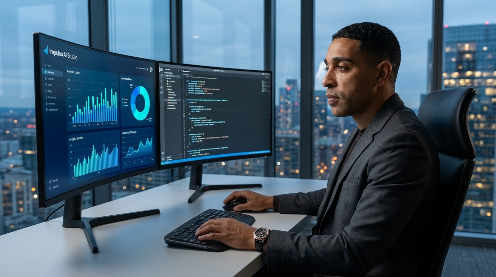

# Impulso AI Studio — Do Conceito à Realidade com IA Generativa

> Projeto educacional desenvolvido para o desafio **Natural ou Fake Natty?**, da [DIO](https://github.com/digitalinnovationone/lab-natty-or-not).

## 📒 Descrição

Este projeto explora a criação de uma imagem **fotorrealista com inteligência artificial generativa** para representar um possível ambiente de trabalho da **Impulso AI Studio**, iniciativa em desenvolvimento dedicada a dashboards, análise de dados, automações e soluções de IA para empresas.

O conceito mostra um profissional em um escritório executivo, diante de dois monitores: um com indicadores e gráficos de análise de dados, outro com um editor de código. A cena é fictícia, inspirada em referências visuais, e **não representa uma fotografia real da sede da empresa nem um produto já comercializado**.

## 🤖 Tecnologias Utilizadas

- **DIO Agent no Google Antigravity:** apoio à definição do conceito, refinamento do briefing e condução da atividade.
- **Ferramenta de geração de imagem acessada durante o projeto:** produção da cena escolhida com assistência de IA generativa. O modelo específico deve ser confirmado no ambiente em que a imagem foi gerada.
- **ChatGPT:** exploração de alternativas visuais e comparação crítica de resultados.
- **Engenharia de prompts:** descrição e refinamento de ambiente, sujeito, postura, cores, iluminação e interfaces.
- **Git e GitHub:** fork do repositório, documentação e apresentação do desafio.

## 🧐 Processo de Criação

1. **Definição do objetivo:** criar uma imagem realista para comunicar a proposta visual da Impulso AI Studio.
2. **Briefing:** escolha de um profissional solo, escritório sofisticado, dois monitores, paleta escura em grafite/preto com azul elétrico, ciano e pequenos alertas vermelhos.
3. **Geração e experimentação:** utilização de ferramentas de IA generativa para produzir propostas visuais com foco em dashboards, código e ambientação corporativa.
4. **Avaliação comparativa:** análise das imagens produzidas, observando composição, iluminação, interfaces e fidelidade à referência facial. Foram identificadas limitações na semelhança da pessoa retratada.
5. **Escolha do resultado:** seleção da imagem que melhor comunicou a atmosfera desejada para a marca, com identificação explícita de sua origem sintética.

## 🚀 Resultados

**Imagem final:** `impulso_ai_studio_conceito.jpg` — conceito visual fictício produzido com IA generativa.

A cena apresenta um painel de análise de dados no monitor esquerdo, um editor de código no direito e um ambiente executivo com vista urbana. Os elementos visuais simbolizam a combinação de análise de dados e desenvolvimento de software proposta pela Impulso AI Studio.

> **Transparência:** o profissional, a sala, os dashboards e os indicadores exibidos na composição são elementos de uma imagem gerada por IA. Não devem ser interpretados como fotografia documental nem como resultados empresariais reais.

## 💭 Reflexão

Este desafio mostrou que um prompt detalhado ajuda a orientar a criação de imagens convincentes, mas que realismo visual não é sinônimo de fidelidade perfeita: detalhes faciais e textos em interfaces podem apresentar diferenças ou erros. Comparar resultados, reconhecer limitações e declarar o uso de IA são partes importantes do processo criativo.

A atividade também permitiu praticar documentação e publicação de um projeto no GitHub.

---

**Autor:** Vinicius Ferreira  
**Portfólio:** [GitHub — ViniciusFerreiraRS](https://github.com/ViniciusFerreiraRS)  
**Desafio:** #LabDIONattyOrNot
